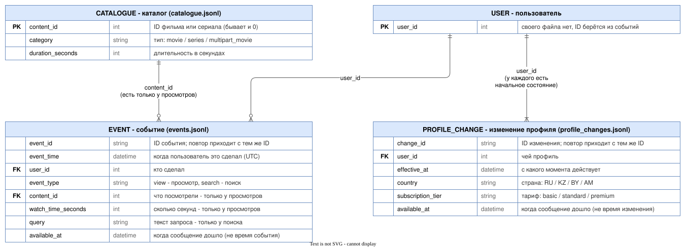
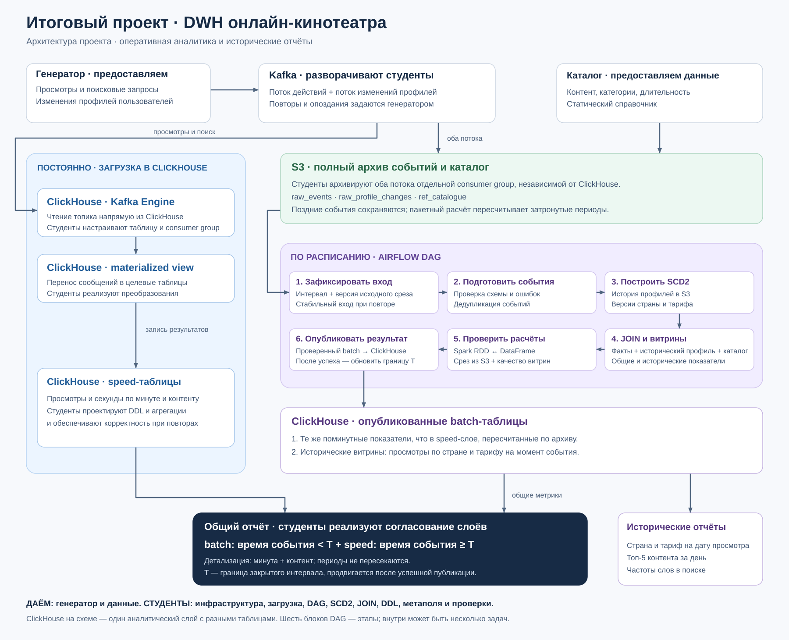

# DWH онлайн-кинотеатра - решение итогового проекта

Хранилище данных онлайн-кинотеатра по Lambda-архитектуре:
- свежие события из Kafka сразу попадают в оперативные показатели ClickHouse;
- полный архив событий копится в S3, по расписанию его обрабатывают Airflow + Spark (очистка, SCD2 профилей,
  исторический JOIN, витрины, проверки) и публикуют результат в ClickHouse;
- общий отчёт склеивает оба слоя по границе T без дыр и двойного счёта.

Текст задания - [`ASSIGNMENT.md`](ASSIGNMENT.md), требования - [`REQUIREMENTS.md`](REQUIREMENTS.md).

## Содержание

- [Коротко о решении](#коротко-о-решении)
- [Быстрый старт](#быстрый-старт)
- [Исходные данные: с чем работаем](#1-исходные-данные-с-чем-работаем)
- [Архитектура](#2-архитектура)
- [Хранилище: S3 и ClickHouse](#3-хранилище-s3-и-clickhouse)
- [Пакетный контур: DAG `cinema_batch`](#4-пакетный-контур-dag-cinema_batch)
- [Демонстрация: сценарии с выводами запросов](#5-демонстрация-сценарии-с-выводами-запросов)
- [Проектные решения и почему так](#6-проектные-решения-и-почему-так)
- [Эксплуатация: версии, логи, тесты, структура](#7-эксплуатация-версии-логи-тесты-структура)

## Коротко о решении

| Контур | Как устроен |
|---|---|
| **Оперативный** (непрерывно) | `cinema.events` -> `speed_events_queue` (Kafka Engine) -> `speed_events_mv` -> `speed_views` (ReplacingMergeTree, дедуп по `event_id`) -> `speed_views_minute` (VIEW с `FINAL`) |
| **Архив** (непрерывно) | сервис `archiver` (своя consumer group) -> `raw/events/`, `raw/profile_changes/` в S3; каталог - `raw/catalogue/` |
| **Пакетный** (Airflow, сутки UTC) | срез -> очистка и дедуп -> SCD2 -> исторический JOIN и 4 витрины -> сверка RDD/DataFrame и проверки -> публикация (`REPLACE PARTITION`) -> сдвиг T |
| **Общий отчёт** | `report_views_minute`: `batch` при `minute_start < T`, `speed` при `minute_start >= T` |
| **Поздние данные** | каждый запуск сам находит новые файлы архива и пересчитывает затронутые сутки, включая уже опубликованные |

## Быстрый старт

Нужен Docker (команды демо-скрипта - в bash, на Windows подойдёт Git Bash).

```bash
cp .env.example .env                 # необязательно: без .env берутся те же значения
docker compose up -d --build         # Kafka, ClickHouse, S3, Airflow, архиватор
```

<details>
<summary>Запуск тестов</summary>

```bash
docker compose run --rm tools pytest -q                   # юнит-тесты (Spark в контейнере)
docker compose run --rm tools pytest -q -m integration    # интеграционные (нужен поднятый стенд)
```

</details>

Запуск демо:
- одним скриптом:

  ```bash
  bash scripts/demo/run_scenarios.sh fixture                 # три демо-сценария -> docs/demo/fixture/
  ```

- вручную, по шагам:

  ```bash
  # 1) отправить первую часть сообщений и дождаться, пока архиватор сохранит их в S3
  docker compose run --rm tools python scripts/replay_kafka.py --dataset data/fixture --bootstrap-servers kafka:9092 --until-arrival 2026-01-04T00:00:00Z
  docker compose run --rm tools python scripts/wait_for_archive.py --dataset data/fixture --until-arrival 2026-01-04T00:00:00Z
  # 2) пакетный расчёт за сутки (так же, как плановый запуск)
  docker compose exec airflow-scheduler airflow dags backfill cinema_batch -s 2026-01-01 -e 2026-01-01
  # 3) общий отчёт
  docker compose exec -T clickhouse clickhouse-client --user cinema --password cinema --queries-file /dev/stdin < clickhouse/queries/01_report_by_source.sql
  ```

| Интерфейс | Адрес | Доступ |
|---|---|---|
| Airflow | http://localhost:8080 | `student` / `student` |
| ClickHouse (HTTP) | http://localhost:8123 | `cinema` / `cinema` |
| S3-консоль RustFS | http://localhost:9001 | `cinema-access` / `cinema-secret-key` |
| Kafka (с хоста) | `localhost:9094` | - |

Наборы данных:
- `fixture` - 3 пользователя, 26 уникальных событий: ручная проверка, ответ известен заранее;
- `demo` - 100 пользователей, 6 000 уникальных событий: сквозной запуск на объёме.

Наборы нельзя смешивать в одних расчётах. Смена набора (`fixture` -> `demo`):

1. `docker compose down -v` - удалить тома со старыми данными;
2. `DATASET=demo docker compose up -d` (или `DATASET=demo` в `.env`);
3. `bash scripts/demo/run_scenarios.sh demo`.

## Соответствие требованиям

<details>
<summary>Таблица: требование -> где реализовано -> доказательство</summary>

| Требование ([`REQUIREMENTS.md`](REQUIREMENTS.md)) | Где реализовано | Доказательство |
|---|---|---|
| 1. Kafka Engine -> MV -> целевые таблицы, просмотры и секунды по минуте и контенту | [`clickhouse/ddl/1*`](clickhouse/ddl/) | [`00-speed-stage1.txt`](docs/demo/fixture/00-speed-stage1.txt), [`04-speed-duplicates.txt`](docs/demo/fixture/04-speed-duplicates.txt) |
| 2. Полный архив в S3, отдельная consumer group, поздние сообщения | [`archiver/archiver.py`](archiver/archiver.py), [`scripts/load_catalogue.py`](scripts/load_catalogue.py) | [`04-kafka-groups.txt`](docs/demo/fixture/04-kafka-groups.txt), [`04-archive-files.txt`](docs/demo/fixture/04-archive-files.txt), [`tests/test_archiver.py`](tests/test_archiver.py) |
| 3. SCD2 профилей, интервалы без пересечений | [`cinema_dwh/transforms/scd2.py`](cinema_dwh/transforms/scd2.py) | [`04-late-scd2.txt`](docs/demo/fixture/04-late-scd2.txt), [`tests/test_transform_scd2.py`](tests/test_transform_scd2.py) |
| 4. Spark: очистка, дедуп, JOIN с каталогом, исторический JOIN; 4 витрины в ClickHouse | [`cinema_dwh/transforms/`](cinema_dwh/transforms/), [`clickhouse/ddl/2*`](clickhouse/ddl/) | [`01-after-jan1-boundary.txt`](docs/demo/fixture/01-after-jan1-boundary.txt) -> [`04-late-boundary.txt`](docs/demo/fixture/04-late-boundary.txt), [`04-late-country-tier.txt`](docs/demo/fixture/04-late-country-tier.txt), [`tests/test_transform_marts.py`](tests/test_transform_marts.py) |
| 5. Сверка RDD и DataFrame на одном наборе из S3 | [`cinema_dwh/rdd/marts_rdd.py`](cinema_dwh/rdd/marts_rdd.py), задача `compare_rdd_df` | [`04-jan4-checks-rdd_vs_df.json`](docs/demo/fixture/04-jan4-checks-rdd_vs_df.json), [`tests/test_rdd.py`](tests/test_rdd.py) |
| 6. Airflow DAG по расписанию, период из параметров, пересчёт истории | [`dags/cinema_batch.py`](dags/cinema_batch.py) | [`05-param-runs.txt`](docs/demo/fixture/05-param-runs.txt), [`08-dag-runs.txt`](docs/demo/fixture/08-dag-runs.txt), [скриншот Airflow](docs/demo/airflow-grid.png), [`tests/test_dag.py`](tests/test_dag.py) |
| 7. Общий отчёт: batch до T, speed от T, T по границе минуты после публикации | [`clickhouse/ddl/40_report_views_minute.sql`](clickhouse/ddl/40_report_views_minute.sql), задача `advance_serving_boundary` | [`01-after-jan1-report.txt`](docs/demo/fixture/01-after-jan1-report.txt), [`tests/test_boundary.py`](tests/test_boundary.py) |
| Повторы не завышают показатели; повторный запуск не меняет цифры | дедуп в speed и batch, `REPLACE PARTITION` | [`04-speed-duplicates.txt`](docs/demo/fixture/04-speed-duplicates.txt), [`03-rerun-before.txt`](docs/demo/fixture/03-rerun-before.txt) = [`03-rerun-after.txt`](docs/demo/fixture/03-rerun-after.txt) |
| Поздние события и профили -> пересчёт затронутой истории | [`cinema_dwh/snapshot.py`](cinema_dwh/snapshot.py) | [`04-late-runs.txt`](docs/demo/fixture/04-late-runs.txt), [`04-late-country-tier.txt`](docs/demo/fixture/04-late-country-tier.txt) |
| Метаполя: run_id, интервал, время обработки | `add_meta` в [`run_context.py`](cinema_dwh/run_context.py) | [`03-rerun-meta-before.txt`](docs/demo/fixture/03-rerun-meta-before.txt) / [`03-rerun-meta-after.txt`](docs/demo/fixture/03-rerun-meta-after.txt) |
| Проверки перед публикацией останавливают её | [`cinema_dwh/checks.py`](cinema_dwh/checks.py) | [`07-quality-fail-task-states.txt`](docs/demo/fixture/07-quality-fail-task-states.txt), [`07-quality-fail-checks-quality.json`](docs/demo/fixture/07-quality-fail-checks-quality.json), [`tests/test_checks.py`](tests/test_checks.py) |
| Код, DDL, DAG, конфиги развёртывания, README с запуском и запросами | весь репозиторий | этот файл, [`clickhouse/queries/`](clickhouse/queries/) |

</details>

---

## 1. Исходные данные: с чем работаем

### 1.1 Откуда берутся данные

Входные файлы лежат в `data/fixture/` и `data/demo/`. Скрипт `scripts/replay_kafka.py` читает их и отправляет
строки в Kafka в порядке `available_at` - так имитируется «живой» поток, вместе с повторами и опозданиями.
Каталог в Kafka не идёт: его кладёт в S3 скрипт `scripts/load_catalogue.py`.

### 1.2 Сущности и связи

Во входных данных три сущности: каталог, событие (просмотр или поиск) и изменение профиля. Отдельной таблицы
пользователей **нет** - пользователь существует только как `user_id` внутри событий и изменений профиля.



### 1.3 Паспорт набора - `manifest.json`

Поля всех трёх сущностей с описаниями - на схеме выше. Кроме них в каждом наборе есть `manifest.json`:
не данные, а описание набора с параметрами генерации и контрольными числами. В Kafka он не отправляется.

Полезные поля:
- `dataset_id` - префикс всех ID набора;
- `unique_events`, `unique_changes` - сколько уникальных событий и изменений профиля;
- `suggested_arrival_cutoff` - граница двух этапов отправки;
- `event_time_min` / `event_time_max` - диапазон времени событий.

Контрольные числа удобно использовать в проверках («после дедупликации событий ровно `unique_events`»).

---

## 2. Архитектура

Схема из задания (что требуется) и наша полная схема данных (как это сделано, с точными именами;
серым - объекты, которые мы создаём):




---

## 3. Хранилище: S3 и ClickHouse

### 3.1 Оперативный контур (ClickHouse)

| Объект | Тип | Зачем |
|---|---|---|
| [`speed_events_queue`](clickhouse/ddl/10_speed_events_queue.sql) | ENGINE = Kafka (`JSONAsString`) | читает топик своей группой; данных не хранит |
| [`speed_events_mv`](clickhouse/ddl/12_speed_events_mv.sql) | MATERIALIZED VIEW -> `speed_views` | разбирает JSON, оставляет просмотры |
| [`speed_views`](clickhouse/ddl/11_speed_views.sql) | ReplacingMergeTree(`ingested_at`), `PARTITION BY toDate(event_time)`, `ORDER BY (minute, content_id, event_id)` | сырые просмотры; повторы схлопываются по `event_id` |
| [`speed_views_minute`](clickhouse/ddl/13_speed_views_minute.sql) | VIEW: `FINAL` + `GROUP BY` минута × контент | оперативные показатели |

### 3.2 Архив и папки запусков (S3, бакет `cinema`)

| Путь | Кто пишет | Что внутри |
|---|---|---|
| `raw/events/ingest_date=…/part-p<партиция>-o<с>-<по>.jsonl` | `archiver` | события как пришли (с повторами) + `kafka_topic`, `kafka_partition`, `kafka_offset`, `archived_at` |
| `raw/profile_changes/…` | `archiver` | изменения профилей так же |
| `raw/catalogue/catalogue.jsonl` | `s3-init` | каталог |
| `batch/<run_id>/snapshot.json` | `freeze_snapshot` | срез: имена файлов `raw/` и какие из них новые (`new_files`) |
| `batch/<run_id>/clean_events/`, `rejected_events/`, `clean_profile_changes/` | `prepare_data` | очищенные данные (Parquet) |
| `batch/<run_id>/user_profile_scd2/` | `build_user_profile_scd2` | SCD2-история |
| `batch/<run_id>/views_enriched/`, `marts/<витрина>/` | `build_marts` | просмотры после JOIN; 4 витрины с метаполями |
| `batch/<run_id>/checks/rdd_vs_df.json`, `quality.json` | `compare_rdd_df`, `quality_checks` | итоги проверок |

Всё, что сделал запуск, лежит в его папке - по пути видно происхождение, а повтор запуска
перезаписывает только свою папку.

### 3.3 Пакетные и служебные таблицы (ClickHouse)

| Таблица | Что хранит |
|---|---|
| `batch_views_minute` | поминутные просмотры и секунды по контенту - те же показатели, что в speed-слое |
| `batch_views_country_tier_daily` | просмотры по дням, странам и тарифам на момент просмотра |
| `batch_top_content_daily` | топ-5 контента за день |
| `batch_search_words_daily` | частоты поисковых слов по дням |
| `batch_runs` | журнал запусков: интервал, срез, затронутые сутки и причины, статус |
| `serving_boundary` | граница T: каждая строка - один сдвиг, текущая T - максимальная |
| `report_views_minute` | общий отчёт (VIEW): batch до T, speed от T |

Во всех batch-таблицах есть метаполя `run_id`, `interval_start`, `interval_end`, `processed_at`. Поля и
типы - на схеме данных в разделе 2 и в [`clickhouse/ddl/`](clickhouse/ddl/).

---

## 4. Пакетный контур: DAG `cinema_batch`

```
resolve_run_context -> freeze_snapshot -> prepare_data -> build_user_profile_scd2 -> build_marts
                                                                                 ├-> compare_rdd_df ─┐
                                                                                 └-> quality_checks ─┴-> publish_to_clickhouse -> advance_serving_boundary
```

### 4.1 Как обрабатываются поздние данные

1. Архиватор пишет любое сообщение в новый файл `raw/` - поздние ничем не отличаются.
2. `freeze_snapshot` сравнивает файлы среза с файлами срезов всех опубликованных запусков -> `new_files`.
3. `prepare_data` читает новые файлы:
   - новое событие -> его сутки;
   - новое изменение профиля -> все сутки с `effective_at` (оно действует на все последующие просмотры);
   - сутки интервала запуска - всегда;
   - будущие, ещё не публиковавшиеся сутки откладываются до их собственного запуска.
4. Витрины затронутых суток считаются **по полному срезу**, SCD2 - **по всей истории** (позднее изменение
   встаёт на своё место), публикация подменяет эти сутки целиком.
5. Защита от отката: срез старше последней публикации опубликовать нельзя - перезапуск старого
   запуска не вернёт устаревшие цифры. Проверка стоит сразу после фиксации среза (до расчёта) и ещё раз
   перед публикацией; данные уже опубликованного запуска при этом остаются в отчёте (`published_at`).

Ограничение Lambda-архитектуры: позднее событие с временем **до T** попадает в speed-слой сразу, но в общем
отчёте этот период берётся из batch, поэтому событие станет видно после ближайшего пакетного пересчёта.

---

## 5. Демонстрация: сценарии с выводами запросов

Все сценарии выполнены скриптом [`scripts/demo/run_scenarios.sh`](scripts/demo/run_scenarios.sh) на чистом стенде;
выводы запросов сохранены как есть. Подробный разбор с выдержками - [`docs/demo/README.md`](docs/demo/README.md),
файлы - [`docs/demo/fixture/`](docs/demo/fixture/) (ответ известен заранее) и [`docs/demo/demo/`](docs/demo/demo/) (6 000 событий).

| Сценарий | Что показано (fixture) |
|---|---|
| 1. Обычная обработка | после запуска за 1 января T = 2 января: 1 января из batch (11 просмотров / 1265 с), 2-3 января из speed; повтор `e00000001` лежит в архиве 3 раза, учтён 1 раз |
| 2. Повторный запуск | контрольные суммы всех витрин до и после совпали; тот же `run_id`, новое `processed_at` |
| 3. Поздние данные | запуск за 4 января сам нашёл и пересчитал 1-4 января; 11:59:59 - RU, с 12:00:00 - KZ; за 1 января `RU basic 8 / 788` и `KZ basic 4 / 597`, итого 20 / 3141 |
| 4. Пересчёт периода по параметрам | один запуск с интервалом 1-4 января, цифры не изменились |
| 5. Старый срез | перезапуск старого запуска отклонён до расчёта, отчёт не откатился |
| 6. Проваленная проверка | просмотр несуществующего контента: `quality_checks` упала, публикации нет, T не сдвинулась |

Как читать файлы в `docs/demo/<набор>/`:
- номер в начале имени - шаг демо по порядку: 
  - `00`-`02` - сценарий 1, 
  - `03` - повторный запуск,
  - `04` - поздние данные, 
  - `05` - пересчёт по параметрам, 
  - `06` - старый срез, 
  - `07` - проваленная проверка,
  - `08` - список всех запусков DAG;
- первая строка каждого файла (`-- ...`) говорит, что он показывает, дальше - сам запрос и его вывод;
- `*-checks-*.json` - отчёты проверок запуска (сверка RDD/DataFrame и проверки качества) как есть из S3;
- к каждому требованию нужный файл указан в таблице [«Соответствие требованиям»](#соответствие-требованиям),
  разбор по шагам - в [`docs/demo/README.md`](docs/demo/README.md).

Примеры запросов к итоговым отчётам - [`clickhouse/queries/`](clickhouse/queries/):

| Файл | Что показывает |
|---|---|
| `01_report_by_source.sql` | общий отчёт по суткам: из какого слоя (batch / speed) и итоги; граница T |
| `02_report_minutes.sql` | общий отчёт «минута × контент» |
| `03_country_tier_daily.sql` | просмотры по стране и тарифу на дату просмотра |
| `04_top5_daily.sql` | дневной топ-5 контента |
| `05_search_words_daily.sql` | частоты поисковых слов |
| `06_runs.sql` | журнал запусков: интервал, затронутые сутки и причины, статус |
| `07_scd2_user.sql` | SCD2-история профилей прямо из S3 |
| `08_views_enriched_boundary.sql` | исторический JOIN на границе версии профиля |
| `09_raw_duplicates.sql` | повторы в архиве против одного просмотра в speed-слое |

```bash
docker compose exec -T clickhouse clickhouse-client --user cinema --password cinema --queries-file /dev/stdin < clickhouse/queries/03_country_tier_daily.sql
```

---

## 6. Проектные решения и почему так

| Решение | Почему |
|---|---|
| Повторы в speed-слое убирает `ReplacingMergeTree` по `event_id`, суммы считает VIEW с `FINAL` | MV видит только новую пачку и посчитал бы повтор дважды |
| Архиватор фиксирует offset только после записи файла в S3 | при сбое будет дубль, но не потеря; дубли убирает batch |
| Срез запуска - список файлов архива | повторный запуск читает те же файлы и даёт те же цифры |
| Пересчитываются сутки, которых коснулись новые файлы | опоздание любой длины не теряется, лишнее не пересчитывается |
| SCD2 строится заново по всей истории | позднее изменение профиля само встаёт на своё место |
| Профиль к просмотру - по условию `valid_from <= event_time < valid_to` | берётся версия на момент просмотра, а не текущая |
| Публикация подменяет сутки целиком (`REPLACE PARTITION`) и только после проверок | повтор не создаёт дублей, плохие данные не попадают в отчёт |
| T двигается только вперёд и только по сплошной цепочке опубликованных суток | в общем отчёте нет дыр и двойного счёта |
| Spark в local-режиме внутри Airflow | весь стенд помещается на одной машине |

---

## 7. Эксплуатация: версии, логи, тесты, структура

**Версии компонентов**

| Компонент | Версия |
|---|---|
| Kafka (KRaft, один брокер) | `apache/kafka:3.9.0` |
| ClickHouse | `clickhouse/clickhouse-server:24.8.14.39` |
| S3 (RustFS) | `rustfs/rustfs:1.0.4` |
| Airflow и его метаданные | `apache/airflow:2.10.5-python3.11`, `postgres:16.6-bookworm` |
| Spark | `pyspark==3.5.4`, Java 17, S3A: `hadoop-aws 3.3.4`, `aws-java-sdk-bundle 1.12.262` |
| Python-клиенты | `confluent-kafka==2.15.0`, `boto3==1.36.3`, `clickhouse-connect==0.8.15` |

Остальные Python-зависимости закреплены constraints-файлом Airflow - [`docker/constraints-3.11.txt`](docker/constraints-3.11.txt).

**Логи**
- задачи DAG - в UI Airflow (у каждой попытки свой лог со сводкой «ключ : значение») и в томе `airflow-logs`;
- сервисы - `docker compose logs <сервис>` (например, `archiver` пишет каждую сохранённую пачку);
- ClickHouse - том `clickhouse-logs`.

Состояние всех сервисов хранится в именованных томах и переживает перезапуск; полный сброс - `docker compose down -v`.

**Тесты** ([`tests/`](tests/))
- юнит-тесты на точных числах fixture: дедуп, SCD2, витрины, RDD = DataFrame, проверки, затронутые сутки,
  граница T, структура DAG;
- интеграционные (`-m integration`): публикация в ClickHouse, журнал запусков.

**Структура репозитория**

```
├── README.md (этот файл), ASSIGNMENT.md (задание), REQUIREMENTS.md, INFRASTRUCTURE.md
├── docker-compose.yaml, .env.example
├── docker/              - Dockerfile образа проекта, constraints, конфиги ClickHouse и Kafka
├── clickhouse/ddl/      - DDL по файлу на объект (выполняется при первом старте ClickHouse)
├── clickhouse/queries/  - примеры запросов к отчётам
├── archiver/            - сервис Kafka -> S3
├── cinema_dwh/          - пакетный контур: transforms/ (чистые функции), rdd/, snapshot, checks, clickhouse, tasks/
├── dags/cinema_batch.py - DAG
├── scripts/             - скрипты курса + load_catalogue, wait_for_archive, demo/run_scenarios.sh
├── tests/               - pytest
└── docs/                - design.md, plan.md, diagrams/, demo/
```
