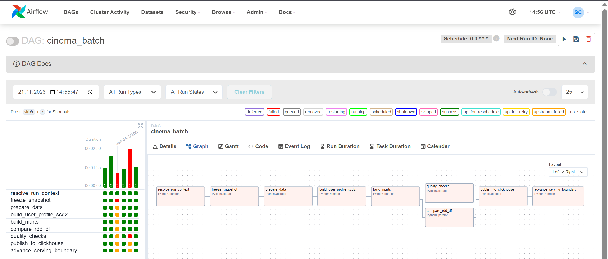

# Демонстрация: сценарии с выводами запросов

## 1. Обычная обработка

Отправлена первая часть сообщений (`available_at < 2026-01-04`), выполнен запуск за 1 января.
Граница T = 2 января: 1 января берётся из batch, 2-3 января - из speed
([`01-after-jan1-report.txt`](fixture/01-after-jan1-report.txt)):

```
   ┌─day────────┬─source──────────────┬─minutes─┬─views─┬─watch_seconds─┐
1. │ T          │ 2026-01-02 00:00:00 │    ᴺᵁᴸᴸ │  ᴺᵁᴸᴸ │          ᴺᵁᴸᴸ │
2. │ 2026-01-01 │ batch               │      11 │    11 │          1265 │
3. │ 2026-01-02 │ speed               │       6 │     6 │          1251 │
4. │ 2026-01-03 │ speed               │       2 │     2 │           505 │
   └────────────┴─────────────────────┴─────────┴───────┴───────────────┘
```

Повторная доставка не завышает цифры: `e00000001` лежит в архиве трижды, а в speed-слое учтён один раз
([`04-speed-duplicates.txt`](fixture/04-speed-duplicates.txt)):

```
   ┌─event_id───────────────┬─copies_in_archive─┬─rows_in_speed_final─┐
1. │ 38b65ed6e0b0-e00000001 │                 3 │                   1 │
   └────────────────────────┴───────────────────┴─────────────────────┘
```

- архиватор и ClickHouse читают поток разными consumer group, обе дочитали всё (LAG = 0) -
  [`04-kafka-groups.txt`](fixture/04-kafka-groups.txt);
- файлы архива и число строк в каждом - [`04-archive-files.txt`](fixture/04-archive-files.txt);
- сверка RDD и DataFrame и проверки качества каждого запуска - в JSON:
  [`01-jan1-checks-rdd_vs_df.json`](fixture/01-jan1-checks-rdd_vs_df.json),
  [`01-jan1-checks-quality.json`](fixture/01-jan1-checks-quality.json).

## 2. Повторный запуск

DAG run за 3 января перезапущен (`--reset-dagruns`) на том же срезе:
- контрольные суммы бизнес-полей всех витрин до и после совпадают -
  [`03-rerun-before.txt`](fixture/03-rerun-before.txt) = [`03-rerun-after.txt`](fixture/03-rerun-after.txt);
- у строк тот же `run_id` и новое `processed_at`
  ([`03-rerun-meta-before.txt`](fixture/03-rerun-meta-before.txt), [`03-rerun-meta-after.txt`](fixture/03-rerun-meta-after.txt)):

```
до:     │ b20260103_51477cb5 │ 2026-01-03 00:00:00 │ 2026-01-04 00:00:00 │ 2026-11-21 14:15:43 │
после:  │ b20260103_51477cb5 │ 2026-01-03 00:00:00 │ 2026-01-04 00:00:00 │ 2026-11-21 14:16:57 │
```

## 3. Поздние данные и пересчёт истории

Отправлена вторая часть:
- поздний просмотр `e00000020` за 1 января;
- третья доставка `e00000001`;
- позднее изменение профиля `p00000007` («1001 в KZ с 1 января 12:00»).

Запуск за 4 января сам нашёл затронутые сутки и записал причины ([`04-late-runs.txt`](fixture/04-late-runs.txt)):

```
│ b20260104_79b74389 │ 2026-01-04 │ 2026-01-05 │ ['2026-01-01','2026-01-02','2026-01-03','2026-01-04'] │ published │
  [{"date": "2026-01-04", "why": "interval"}, {"date": "2026-01-01", "why": "new_event", ...}, {"why": "new_profile_change", ...}]
```

Исторический JOIN берёт версию профиля на момент просмотра: 11:59:59 - ещё RU, ровно 12:00:00 - уже KZ
(до: [`01-after-jan1-boundary.txt`](fixture/01-after-jan1-boundary.txt), после: [`04-late-boundary.txt`](fixture/04-late-boundary.txt)):

```
   ┌─event_id───────────────┬──────────event_time─┬─content_id─┬─country─┬─profile_version─┐
1. │ 38b65ed6e0b0-e00000008 │ 2026-01-01 11:59:59 │          0 │ RU      │               1 │
2. │ 38b65ed6e0b0-e00000009 │ 2026-01-01 12:00:00 │          1 │ KZ      │               2 │
3. │ 38b65ed6e0b0-e00000010 │ 2026-01-01 12:00:01 │          2 │ KZ      │               2 │
4. │ 38b65ed6e0b0-e00000020 │ 2026-01-01 13:00:00 │          0 │ KZ      │               2 │
   └────────────────────────┴─────────────────────┴────────────┴─────────┴─────────────────┘
```

- витрина по стране и тарифу за 1 января: вместо `RU basic 11 / 1265` теперь `RU basic 8 / 788` и `KZ basic 4 / 597` -
  [`04-late-country-tier.txt`](fixture/04-late-country-tier.txt);
- общий отчёт: 1-3 января - 20 просмотров и 3141 секунда, T = 5 января - [`04-late-report.txt`](fixture/04-late-report.txt);
- топ-5 с учётом позднего просмотра - [`04-late-top5.txt`](fixture/04-late-top5.txt);
- SCD2-история с поздней версией - [`04-late-scd2.txt`](fixture/04-late-scd2.txt);
- сверка RDD/DataFrame за 1-4 января - [`04-jan4-checks-rdd_vs_df.json`](fixture/04-jan4-checks-rdd_vs_df.json).

## 4. Пересчёт исторического периода по параметрам

```bash
docker compose exec airflow-scheduler airflow dags backfill cinema_batch -s 2026-01-10 -e 2026-01-10 \
  -c '{"interval_start": "2026-01-01T00:00:00Z", "interval_end": "2026-01-04T00:00:00Z"}'
```

- один запуск пересчитал 1-3 января - [`05-param-runs.txt`](fixture/05-param-runs.txt);
- вход не менялся, поэтому контрольные суммы до и после совпали -
  [`05-param-before.txt`](fixture/05-param-before.txt) = [`05-param-after.txt`](fixture/05-param-after.txt).

## 5. Старый срез не откатывает свежие данные

Перезапуск DAG run за 3 января после пересчёта отклонён уже на `freeze_snapshot` («срез устарел»):
- статус запуска `failed`, но `published_at` сохранён - его данные по-прежнему в отчёте -
  [`06-stale-rerun-runs.txt`](fixture/06-stale-rerun-runs.txt);
- цифры не изменились - [`06-stale-rerun-checksum.txt`](fixture/06-stale-rerun-checksum.txt).

## 6. Проваленная проверка останавливает публикацию

В архив подложен просмотр контента `999999`, которого нет в каталоге. Запуск за 5 января:
- `quality_checks` упала, `publish_to_clickhouse` и `advance_serving_boundary` - `upstream_failed` -
  [`07-quality-fail-task-states.txt`](fixture/07-quality-fail-task-states.txt);
- в отчёте проверок ([`07-quality-fail-checks-quality.json`](fixture/07-quality-fail-checks-quality.json)):

  ```
  one_catalogue_item   false   {"views_without_match": 1, "views_with_several_matches": 0}
  views_reconcile      false   {"views_minute": 6, "views_country_tier_daily": 6, "views_enriched": 6, "clean_events_views": 7}
  ```

- витрины и граница T не изменились - [`07-quality-fail-checksum.txt`](fixture/07-quality-fail-checksum.txt),
  [`07-quality-fail-report.txt`](fixture/07-quality-fail-report.txt).

Все запуски DAG - [`08-dag-runs.txt`](fixture/08-dag-runs.txt).

## Airflow после прогона на наборе `demo`

Столбцы - запуски по дате данных: 1, 2, 3 (перезапуск старого среза, отклонён на `freeze_snapshot`), 4, 5 (проверка
качества остановила публикацию), 10 января (пересчёт 1-3 января по параметрам). Красное здесь - намеренные
негативные сценарии 5 и 6.


